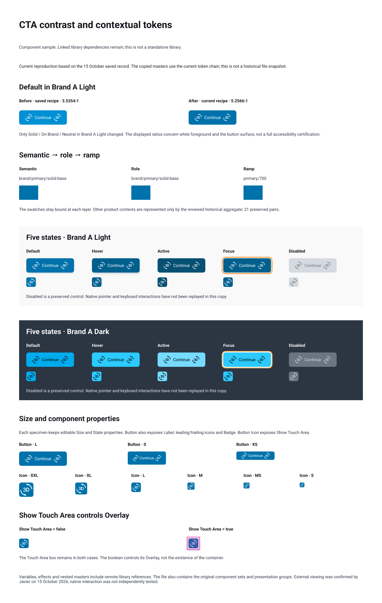

# Working with agents in Figma: a reduced workflow and an Embit case

I am Javier, a Product Designer and the creator of Embit. This sample shows how I directed agents during selected design-system maintenance work on 13–15 October 2026. A button-contrast change provides a short introduction to the selected work record.

I defined the scope and approved the contextual colour decision. Agents inspected the components, applied the approved change, checked instances and recorded the results. A DS Manager Deputy coordinated the work and corrected a test that was checking the wrong behaviour. [E02](#e02-decision-and-scope), [E04](#e04-application-and-readback), [E06](#e06-a-test-that-needed-correction).

There are three ways to read this sample:

- [The short case](#short-case) explains the problem, decision and result.
- [The selected work record](#selected-work-record) is the main evidence route. It follows the work, including the test failure and its correction. The [evidence index](#evidence-index) identifies what supports each claim.
- [The reduced agents-workflow folder](agents-workflow/README.md) contains the system's rules, several role guides and the skills. Start with [one Figma request](agents-workflow/REQUEST.md) and follow [its route through the roles](agents-workflow/WORKFLOW.md).

The folder preserves the structure of my working system. Its source instructions remain in Spanish; the orientation is in English. Live mailboxes, their implementation, private decision records, unrelated roles and full project logs are omitted. It is a reading sample, with declared dependencies, rather than a complete system distribution. The example request explains the route; it is not presented as a recovered historical prompt or as evidence that every role executed the CTA change.

The period is 13–15 October 2026, Mexico City time. The central change was made on 15 October. The previous changelog and a separate Label repair provide context. This is a selection, not a complete account of those three days. The documentary cut includes the 15 October entry for changelog 7.8.0. [E01](#e01-period-and-previous-cut), [E08](#e08-documentation-after-the-change).

### Component sample



[Open the component sample in Figma](https://www.figma.com/design/gcVtxLo6YvYyfCpZ2IJ9UH?node-id=16-8478).

This is a current reproduction based on the saved 15 October record, not a screenshot of the temporary historical comparison. The image is a visual reference; the Figma file contains the component sample and additional presentation groups. Variables, effects and some nested components still reference remote libraries, so the file is not presented as a standalone library. I confirmed that the link opened in a private browser window on 15 October 2026.

These checks concern Figma components, properties, variable resolution and selected rendered states. They do not establish native interaction quality, code integration, CI, automated visual regression, library publication or adoption by product teams.

## Short case

### Problem

In the selected solid-button recipe, Brand A's light-mode Default state had a measured text contrast of 3.5354:1. The earlier contract retained it as an approved exception. The October 15 comparison made the trade-off visible before changing the component. [E02](#e02-decision-and-scope).

### Decision

I approved a change for this recipe in Brand A Light. The change uses contextual roles and semantic surface tokens, so it does not change the shared primary colour or make every brand use the same ramp steps.

| State | Selected ramp step | Semantic surface | Measured text contrast before | Measured text contrast after |
|---|---|---|---|---|
| Default | 700 | `brand/primary/solid-base` | 3.5354:1 | 5.2566:1 |
| Hover | 800 | `brand/primary/solid-strong` | 5.2566:1 | 6.8678:1 |
| Active | 900 | `brand/primary/solid-heavy` | 6.8678:1 | 8.7231:1 |
| Focus | 800 | `brand/primary/solid-strong` | 5.2566:1 | 6.8678:1 |

Scope: Button and Button Icon, `Solid / On Brand / Neutral`, Brand A Light. The ratios are measurements of the selected content and background pair, rounded to four decimals. They are not a full accessibility assessment. Disabled, Brand A Dark and the other brand contexts were outside the colour change. The 700/800/900 sequence is this decision, not a general rule for other palettes. [E02](#e02-decision-and-scope), [E04](#e04-application-and-readback).

### Agent work

The Worker read the two component sets and their variables before applying the change. It added three semantic surfaces and six contextual roles, then changed background fills on 36 active variants: 12 Button and 24 Button Icon. A separate readback by the same Worker checked all 45 faces in the selected recipe, including the nine Disabled faces. The recorded comparison found 21 unchanged surface/context pairs and three changed pairs, all in Brand A Light. [E03](#e03-preflight), [E04](#e04-application-and-readback).

Instance checks covered sizes, states and brand/mode contexts. One check initially flagged the visible Touch Area container. The Deputy clarified that the container stays in place and the boolean controls its Overlay. The Worker inspected that relationship and used the corrected criterion while completing the remaining contexts, without changing the touch-area masters. This was not a rerun of all the first Button Icon combinations. [E05](#e05-button-instance-checks), [E06](#e06-a-test-that-needed-correction).

### Result and limits

The selected Default contrast increased from 3.5354:1 to 5.2566:1. The evidence records the contextual change, unchanged shared variables and a corrected test. It does not show a production release or a measured effect on users. [E04](#e04-application-and-readback).

The contract kept the earlier exception as history and added a later note that supersedes it only for this recipe. The changelog documents the change as 7.8.0; that is not evidence that a Figma library was published or that consumers received it. [E08](#e08-documentation-after-the-change).

## Selected work record

This record is an English summary derived from Spanish work logs, the component contract and saved Figma-check output. It preserves their order and attribution. It does not reconstruct missing chat messages. Times below are the times recorded in the work log, not independently measured execution timestamps.

| Date / recorded time | Request, action or correction | Attribution | Evidence |
|---|---|---|---|
| 13 October | Changelog 7.7.0 was assembled. Its source period was 8–13 October; the sample does not assign all of that work to the 13th. | Recorded changelog work | [E01](#e01-period-and-previous-cut) |
| 14 October | A separate maintenance task restored 75 missing Button Label references. This is context, not the source of the contrast improvement. | Javier's request; agent execution reported in the work log | [E09](#e09-optional-label-context) |
| 15 October, before integration | A temporary comparison showed the existing and proposed Brand A Light CTA colours. At this point it was a proposal, not an applied change. | DS work record | [E02](#e02-decision-and-scope) |
| 15 October, approved work order | Javier approved the contextual ramp selection. The Deputy's recorded work order bounded the components, states, contexts and properties to preserve. | Javier: decision; DS Manager Deputy: work order | [E02](#e02-decision-and-scope) |
| 15 October, 12:08 | Preflight read completed after a first response exceeded the output limit. A smaller read returned the required data; no mutation was reported at this stage. | Worker, GPT-6.1 Sol, high effort | [E03](#e03-preflight) |
| 15 October, 12:16 | Variables and selected root fills were updated. A separate readback checked bindings, contexts and invariants. | Same Worker | [E04](#e04-application-and-readback) |
| 15 October, 12:20 | Button instance checks completed: 120 size/state/context combinations; no failures in the saved output. | Same Worker | [E05](#e05-button-instance-checks) |
| 15 October, 12:23 | Button Icon completed its first 120 combinations. Its touch-area check reported 25 failures. The Worker did not treat them as proof of a master defect. | Same Worker | [E06](#e06-a-test-that-needed-correction) |
| 15 October, before 12:30 | The Deputy corrected the criterion: inspect Overlay visibility, not disappearance of the container. | DS Manager Deputy | [E06](#e06-a-test-that-needed-correction) |
| 15 October, 12:30 | The Worker inspected the layers, completed the remaining 120 Button Icon combinations and checked the corrected touch-area behaviour. Temporary QA instances were removed. | Same Worker | [E06](#e06-a-test-that-needed-correction), [E07](#e07-cleanup-and-reproduction) |
| 15 October, 12:35 | The historical CTA comparison was removed after the result was recorded. | Same Worker | [E07](#e07-cleanup-and-reproduction) |
| 15 October, changelog work opened at 16:26 | The recorded change entered changelog 7.8.0. The contract documents the later, limited replacement of the old exception. | Changelog and contract records | [E08](#e08-documentation-after-the-change) |

The saved counters report 360 size/state/context combinations in total: 120 Button and 240 Button Icon. This is not a set of 360 individually recorded results or unique renders, and it does not mean the first test run had no failures. The 25 initial Touch Area flags and the later corrected check remain part of the record. [E05](#e05-button-instance-checks), [E06](#e06-a-test-that-needed-correction).

### Open at this cut

- At the historical cut, the later Figma sample and external viewing check had not yet been prepared. The component sample above was prepared and checked afterwards.
- Native interaction and full accessibility behaviour are not certified by this work.
- Library publication, downstream receipt and code use are not established by these sources.
- Other DS maintenance remained outside this selection. It is not closed by the sample.
- The Label example is optional. Its original saved output has not yet been independently checked for this extraction.

## Minimal method

This is a derived description of the instructions relevant to this work, not a copy of the full agent system. It separates the historical work from the later preparation of this sample.

### Responsibilities

**Javier** sets the purpose, approves decisions that change the result and decides between alternatives. Here, he approved the contextual colour recipe.

**DS Manager Deputy** coordinates the bounded work, supplies the component and token context, receives results and resolves questions about the intended method. Here, the Deputy corrected the Touch Area test criterion.

**Worker** carries out the assigned read, change and checks. It reports what happened, including failures, without taking ownership of unrelated system decisions or publishing the library.

**Super Agent Admin Deputy**, during sample preparation, selects and cross-checks records, keeps a private source map and coordinates the owners of the Figma copy and presentation. This later extraction is not part of the historical implementation.

Source basis: the working rules for collaborating with Javier, the DS Manager operating guide and the signed work record. These are role descriptions derived for this sample, not complete role prompts.

### The `encargar` skill

The relevant skill is `encargar`, meaning to assign a task. The source was in use before this period; its current source header is dated 12 October 2026. The source instructions are in Spanish. This English outline is a derived copy, not an executable installation or a verbatim historical prompt.

An assignment specifies:

1. The recommended reasoning effort and why the work needs care.
2. The role, purpose and minimum source instructions.
3. What already exists, the exact work boundary and what must not change.
4. For Figma, the working file, target pieces and whether the base is the existing file, a reference copy or a new file.
5. Where the result goes. The delivery record opens before the first change and is updated after each step.
6. A complete continuation prompt if work stops. A new Worker should not need the previous chat.

The closing record has five parts: completed and verified; completed but not verified; not started; the next concrete action; what needs Javier. The CTA work used a bounded work order and a step-by-step delivery with this form. The sample does not claim an independently recorded invocation of the skill during execution.

### Checks and history

Readback is separate from applying a change. A report distinguishes a proposal, an approved decision, an applied change, a check and publication. Historical entries are retained; a later correction explains the difference rather than rewriting what was known earlier. These rules explain why the old contrast exception and the failed test are both visible in this sample.

## Evidence index

This index provides summaries and the explicitly labelled original-field extracts below, not access to the complete private records. The extraction checked the saved output named in E03–E06 and viewed three QA captures. Technical review also checked the cleanup output and recalculated contrast from saved RGBA values. Neither review reran the Figma checks or audited the full historical checker code. The image above is a later reproduction, not one of the historical QA captures. Private file paths, source IDs, account references and unrelated brand names are omitted from this text; the internal preparation record keeps their correspondence outside the public package. The linked Figma file is the sample I reviewed and accepted, including its presentation groups.

### E01: Period and previous cut

**Source:** Spanish Embit work log, changelog 7.7.0 entry dated 13 October 2026. **Transformation:** English summary; unrelated changes omitted.

The changelog covers 8–13 October. It provides the preceding documentation cut, not a claim that all work occurred on 13 October. The selected period adds the 14 October Label repair and the 15 October CTA change.

### E02: Decision and scope

**Sources:** Spanish CTA comparison entry, approved work order and contract note dated 15 October 2026. **Transformation:** English summary; Brand A replaces the source product name. Ramp and semantic token names are retained.

The pilot records the four before/after ratios shown in the short case. The later work order authorizes the recipe only for Brand A Light. The earlier 5 October contract exception is historical for this recipe; the later note supersedes it here, without changing the whole palette or other controls.

The available decision evidence is the recorded approved work order. This sample does not present it as a verbatim transcript of Javier's approval.

### E03: Preflight

**Sources:** Worker entry E1, 15 October 2026, and its saved JSON. **Transformation:** selected counts and an English summary; IDs and keys omitted.

- Button: 450 variants in the full set; 15 faces in the selected recipe.
- Button Icon: 870 variants in the full set; 30 faces in the selected recipe.
- Planned scope: 36 active root fills, with nine Disabled faces excluded.
- The log reports one oversized response followed by a bounded read before writing.

These are counts at this recorded point, not a current census of all Embit components.

### E04: Application and readback

**Sources:** Worker E2 application and separate readback JSON, 15 October 2026. **Transformation:** selected observations; private node and variable identifiers omitted.

| Saved observation | Result |
|---|---|
| Created variable IDs | 9: six contextual roles and three semantic surfaces |
| Mutated node list | 38 entries: 36 active faces plus the two component-set descriptions |
| Face readback | 45 faces; no mismatches reported by the saved face-binding check |
| Surface/context comparison | 24 pairs: 21 preserved, 3 changed |
| Changed contexts | Brand A Light, for the three surfaces |
| Prior shared variables compared | No changes reported in the 22 shared variables compared |
| Invariant comparison | 9,430 nodes; no unexpected IDs reported |

Selected original fields from the saved application result:

```json
{
  "applied": true,
  "invariants": { "checked": 9430, "unexpectedIds": [] }
}
```

The readback records Brand A Light ratios of 5.256596449270318, 6.867758934767214 and 8.72310801252373 for the three surfaces. Focus uses the strong surface. Brand A Dark values are unchanged in that comparison. Technical review recalculated the ratios from the saved opaque sRGB values and confirmed the four-decimal figures in the case. This checks the arithmetic, not the historical execution. The full snapshots and checker code behind the 9,430-node invariant summary were not audited; the summary is not a second independent comparison of every field.

### E05: Button instance checks

**Sources:** Worker E3 saved JSON and QA capture, 15 October 2026. **Transformation:** selected observations and English summary. The capture was inspected during extraction; it is not yet included as a public asset.

Selected original fields from E3, with node identifiers and other fields omitted:

```json
{ "tests": 120, "expectedTests": 120, "complete": true, "failures": [] }
```

These are counters, accompanied in the saved output by 24 aggregate size/context rows, not a list of 120 individual results. Coverage is three sizes, five states and eight brand/mode contexts. The log and 15 boolean-check rows support Label persistence and separate leading/trailing icon-property checks; those checks are not added as new combinations. The inspected capture shows five states, including the focus indication, not every context at once.

### E06: A test that needed correction

**Sources:** Worker E4, E4R and E5 entries; E4/E5 saved check outputs and captures; Deputy clarification recorded between them. **Transformation:** English summary and selected counts. Source wording below remains in Spanish.

> La prueba E4 exigía por error ocultar el contenedor; sus25marcas no prueban una deuda del master.

English translation: The E4 test incorrectly required the Touch Area container to be hidden. Its 25 flags do not establish a defect in the main component.

E4 reports `tests=120`; counting its saved `failures` array gives 25 entries, all marked `kind=touch`. This failure count is a derived count, not an invented original JSON field. E4R records a visible, unpainted Touch Area container and an Overlay whose visibility references Show Touch Area. This is a summary of that relationship, with private IDs omitted.

Selected original fields from E5, with node identifiers and other fields omitted:

```json
{ "tests": 120, "expectedTests": 120, "complete": true, "failures": [] }
```

E5 completes the four remaining contexts and includes 30 touch-area check rows under the corrected criterion. Five XXL rows have no Overlay because the component box already measures 48; they are not five additional overlays tested. E5 does not repeat E4's first 120 combinations under the new criterion. The separate touch-area rows are not added to the 360-combination total. The work log records no touch-master change.

This correction matters to the result: a visible container was not enough evidence of a component defect. The saved outputs and rendered captures still do not certify native touch interaction.

### E07: Cleanup and reproduction

**Sources:** Worker E5/E6 cleanup entries and saved cleanup JSON, 15 October 2026. **Transformation:** English summary; private IDs omitted.

The saved cleanup outputs were checked during technical review: they report 92 QA IDs and 209 comparison IDs absent, with no remaining IDs. This was not a new live-file check. The cleanup entry also corrects an earlier manual QA-node count from 63 to 61 for Button; the earlier entry is preserved.

Any newly prepared comparison must be labelled as a current reproduction based on the saved record. It cannot be presented as a new capture of the retired historical frame.

### E08: Documentation after the change

**Sources:** Embit work log, version profile and contract §4f. **Transformation:** English summary; unrelated release items omitted.

The source documents agree on changelog 7.8.0 dated 15 October 2026. The contract contains both the old 5 October exception and the later contextual replacement. The latter is the applicable note for this recipe. No library publication or downstream receipt is inferred from this documentation.

The current source also includes a later change to the icon/on-brand alias chain, recorded as E9 in the original work order, with colour values preserved. A copy made from that source must describe its actual chain; it is not an exact snapshot of E1/E2. This later technical step is distinct from the optional Label evidence E09 in this sample's index.

### E09: Optional Label context

**Source:** Spanish L1 work record dated 14 October 2026. **Transformation:** English summary. The raw L1 data has not been independently checked for this sample.

The entry reports 75 restored Label references in a 450-variant Button set and 300 persistence checks. The property could look correct while no longer controlling some text layers. The repair restored the reference rather than adding a new property. This is a separate functional-maintenance example; it does not support any colour or contrast claim.

## Scope and provenance

This text replaces the source product name with **Brand A** and refers to unrelated brands collectively. Dates, technical token names, counts, failures and limitations are retained. The full private logs, inbox conversations, original working-file links, local paths, source node IDs and accounts are excluded from this text. English summaries and the selected JSON fields are labelled; the original records remain unchanged.

The historical claims received technical review and the English narrative received editorial review. The later component sample was checked separately against the source: the two main sets retained their variant counts and compared properties, but their library dependencies remain remote. I reviewed and accepted the Figma file, including its additional presentation groups. This is not a claim that the linked file is a fully anonymized or independent design-system export.

This package contains this README and one image of the current reproduction, with a link to the accepted Figma sample. It contains no historical QA captures, full source dumps, private source manifest or repository history. The image does not prove native interaction or replace the saved evidence described above.

